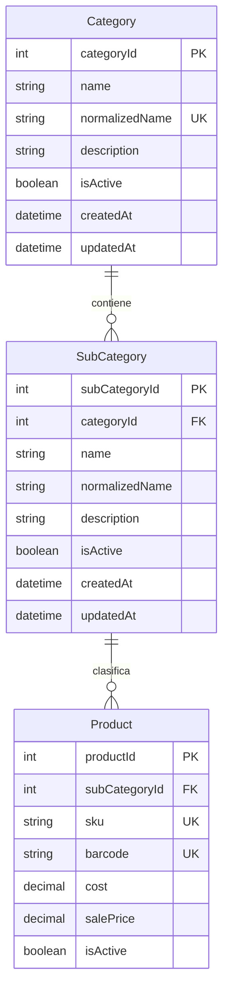
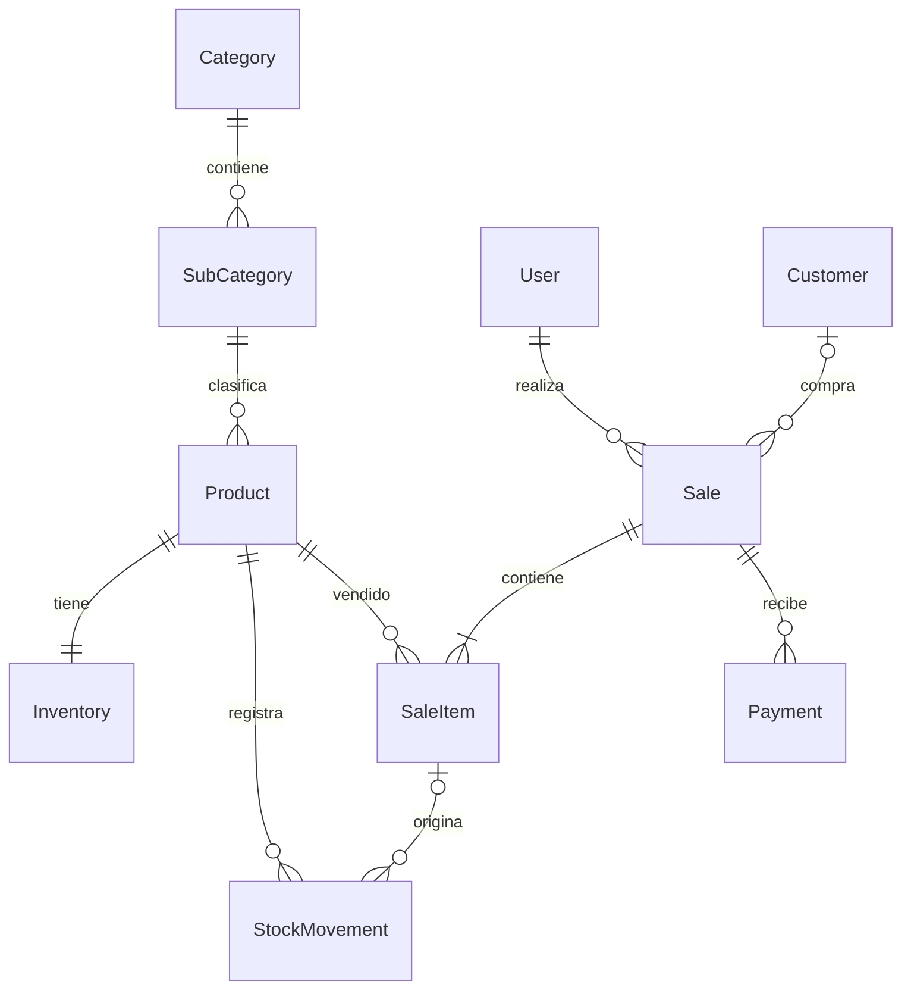

# Diseño de base de datos

Ver [UML de clases](diagrams/uml-classes.md), [estados de pedidos](diagrams/uml-order-states.md)
y el [índice de diagramas](diagrams/README.md).

## Resultado de la revisión

Al revisar el repositorio solo existía `prisma/schema.prisma`, con una tabla
`SubCategory` y un `categoryId` sin clave foránea. No había modelo `Category`,
migraciones ni un diseño de productos, inventario o ventas. Los servicios guardaban
sus datos en memoria.

Actualmente están implementados catálogo, inventario, movimientos, usuarios,
sesiones, recuperación de contraseña, imágenes, pedidos, clientes, ventas y
operaciones de cobro, reembolso, devolución y anulación,
con persistencia PostgreSQL y migraciones versionadas. El esquema Prisma y las
migraciones son la referencia vigente. La propuesta histórica que aparece más
abajo no describe todos los modelos actuales ni debe usarse como lista de pendientes.

## Pedidos implementados

`Order` pertenece a un usuario y un cliente, conserva datos históricos y puede
vincular una única `Sale`. `OrderItem` conserva productos, precios y cantidades;
`OrderOperation` audita transiciones e idempotencia. Las reservas se calculan
desde pedidos PENDING no vencidos sin cambiar Inventory.quantity. Ver
[contrato y estados](orders-api.md).

## Catálogo implementado

- `normalizedName` guarda el nombre en minúsculas, después del recorte de espacios
  de los DTO. No se devuelve en la API. La combinación `(categoryId, normalizedName)`
  es única en subcategorías; los nombres siguen reservados tras una baja lógica.
- La clave foránea impide subcategorías huérfanas y restringe el borrado físico
  de categorías con hijos. El API usa bajas lógicas.
- Las escrituras del catálogo validan y modifican dentro de una transacción.
  Un advisory lock de PostgreSQL serializa estas escrituras entre instancias del
  backend para evitar carreras entre bajas, altas, movimientos y activaciones.
  Las ventas, el inventario y el catálogo comparten este bloqueo mediante
  `PrismaService.catalogWrite`. Las escrituras externas deben respetar las
  mismas reglas; la restricción de padre activo se aplica en el servicio.
- Los PATCH rechazan `null` en `name` y `categoryId`. `description: null` permite
  limpiar una descripción. Las respuestas usan `null` para descripciones ausentes.

## Propuesta histórica para inventario y ventas

Esta sección conserva el diseño inicial, no el contrato vigente. En el modelo
actual una venta requiere cliente; no hay borradores, moneda configurable,
impuestos ni descuentos. Los cobros y reembolsos son `SaleOperation`, no una tabla
`Payment`, y sus estados se calculan a partir de las operaciones. Consulta
[clientes y ventas](customers-sales-api.md), [operaciones](sale-operations-api.md)
y [permisos y pendientes](permissions-and-backlog.md).

Supuestos iniciales: una tienda, cantidades enteras y una moneda configurable.
Antes de implementar productos por peso, sucursales o varias monedas, ajustar esos
supuestos. No agregar un `categoryId` redundante al producto: se obtiene a través
de su subcategoría.

| Tabla / estado         | Campos y restricciones principales                                                                                                                                            |
| ---------------------- | ----------------------------------------------------------------------------------------------------------------------------------------------------------------------------- |
| Product (implementado) | ID, subCategoryId FK, SKU único normalizado, código de barras opcional único, nombre, precio de venta y costo `Decimal(18,2)` no negativos, isActive, fechas                  |
| Inventory              | productId PK/FK, cantidad disponible y mínimo enteros no negativos; una fila por producto                                                                                     |
| StockMovement          | ID, productId FK, tipo (entrada, venta, devolución, ajuste), delta entero distinto de cero, motivo, usuario, saleItemId opcional, fecha                                       |
| User                   | ID, correo normalizado único, hash de contraseña, rol, isActive, fechas                                                                                                       |
| Customer               | ID, nombre, documento opcional, contacto; cliente opcional en ventas de mostrador                                                                                             |
| Sale                   | ID, número único, clave de idempotencia única, usuario FK, cliente opcional FK, estado (borrador, confirmada, anulada), moneda, subtotal, descuento, impuesto, total y fechas |
| SaleItem               | ID, saleId FK, productId FK, cantidad positiva, SKU y nombre históricos, precio unitario, descuento, impuesto y total históricos                                              |
| Payment                | ID, saleId FK, método, importe positivo `Decimal(18,2)`, estado y referencia externa opcional única                                                                           |

### Reglas para implementar con las ventas

1. Calcular importes en el servidor con aritmética decimal y una política explícita
   de redondeo; no confiar en totales enviados por el cliente ni usar `number`
   para cálculos monetarios. Guardar precios e impuestos históricos en cada detalle.
2. Confirmar una venta y descontar inventario en una única transacción. Descontar
   con una actualización condicional `available >= quantity` y comprobar las filas
   afectadas, o bloquear las filas de inventario en orden consistente.
3. Registrar un movimiento por cada cambio de inventario en la misma transacción.
   Evitar modificar stock directamente sin movimiento y usuario responsable.
4. Reintentos con la misma clave de idempotencia no deben generar otra venta ni
   descontar stock de nuevo. Una anulación debe ejecutarse una sola vez, producir
   movimientos inversos y conservar la venta original y su auditoría.
5. Restringir borrados físicos de productos, usuarios y clientes referenciados
   por ventas. Agregar índices para fechas de venta, `(saleId)` en detalles,
   `(productId, createdAt)` en movimientos y claves foráneas usadas en consultas.
6. Pagos externos requieren conciliación: una transacción SQL no puede confirmar
   atómicamente un cobro en otro servicio. Usar referencias idempotentes y estados
   de pago; distinguir anulación, devolución de mercadería y reembolso monetario.

## Migraciones y operación

La migración inicial está pensada para una base vacía. Si alguien creó tablas
manualmente con el esquema anterior, debe preparar una migración de adaptación
(o un baseline verificado) antes de aplicar esta migración. Esta revisión solo
aplica migraciones en una base de pruebas aislada; no modifica bases existentes.

Los datos de los antiguos arreglos en memoria no se pueden recuperar después de
reiniciar el proceso; si todavía hubiera un backend antiguo en ejecución con datos
útiles, exportarlos antes de cambiar a esta versión.
