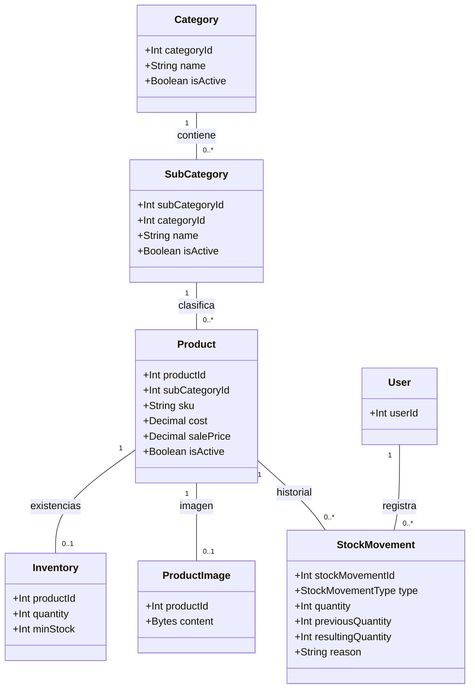
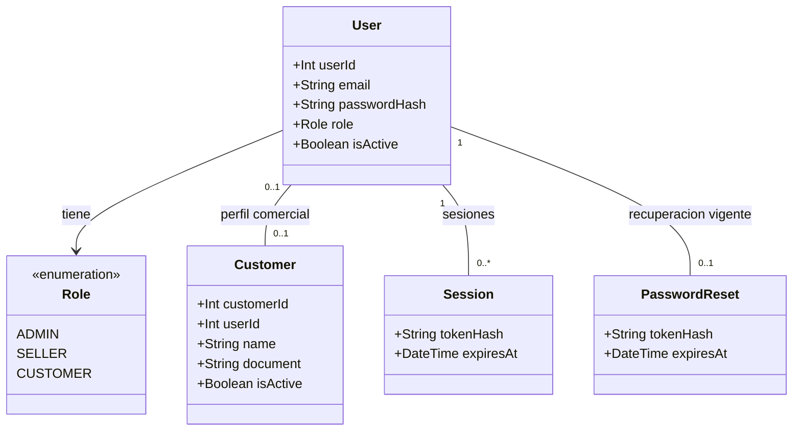
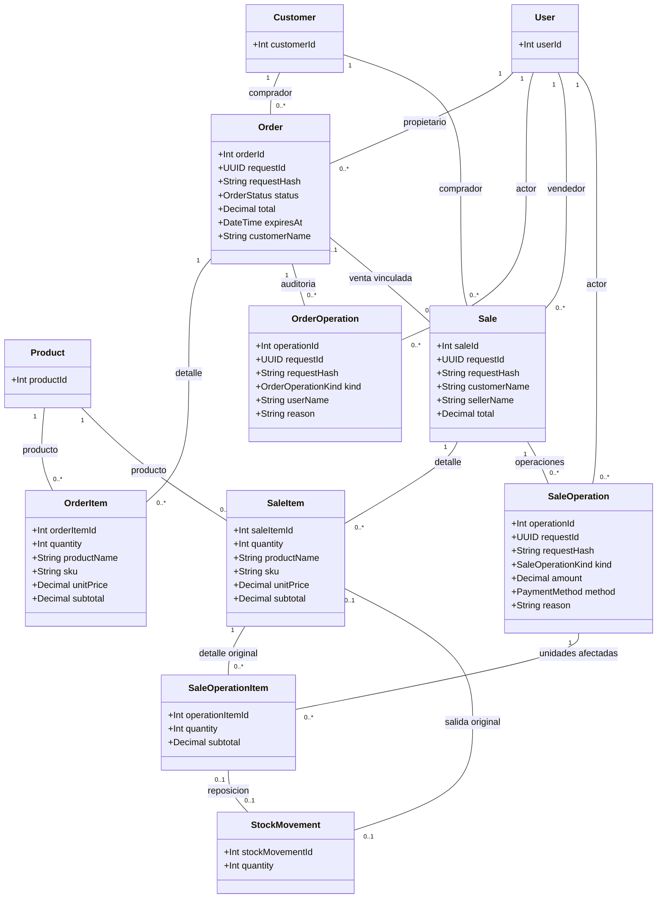

# UML de clases del dominio

[Índice de diagramas](README.md) · [Diseño de datos](../database-design.md)

Se muestran atributos relevantes y asociaciones del esquema Prisma actual.
`0..1` indica una asociación opcional y `0..*` varios registros posibles.
No se representan las asociaciones como composición UML porque los registros
históricos no se eliminan en cascada junto con su entidad padre.

## Catálogo e inventario

Cada producto pertenece a una sola subcategoría y cada subcategoría a una
categoría. `quantity` es stock físico. La disponibilidad se calcula restando
las reservas de pedidos PENDING no vencidos; no existe un contador persistido de
reservas en Inventory. Los movimientos físicos conservan actor y cantidades.

## Usuarios y sesiones

Customer puede existir sin User. User puede no tener perfil comercial; la
compra online exige CUSTOMER con perfil activo vinculado. Session y PasswordReset
guardan hashes, no el token original. Estos atributos internos nunca forman
parte de una respuesta pública.

## Pedidos y ventas

La API exige al menos una línea para pedidos y ventas, aunque las claves
foráneas permiten cero hijos y por eso las asociaciones muestran `0..*`.
Una venta de mostrador no necesita Order. Un pedido pendiente no tiene Sale;
la confirmación los vincula uno a uno y conserva precios históricos.

OrderOperationKind contiene CONFIRM, READY, COMPLETE y CANCEL.
SaleOperationKind contiene PAYMENT, REFUND, RETURN y CANCEL. Los cobros y
reembolsos registran dinero manualmente; no llaman a una pasarela.
El estado y los saldos de Sale se calculan desde sus operaciones; no hay una
columna `Sale.status`. Ver [estados UML de Order](uml-order-states.md).
