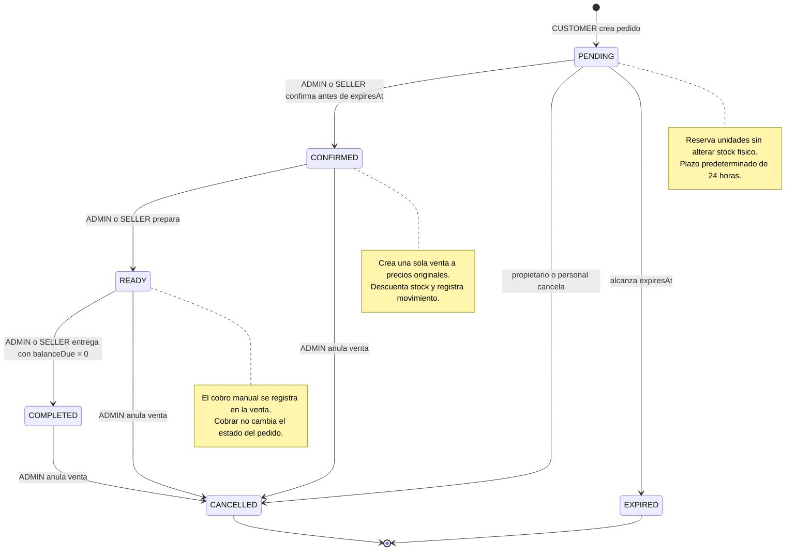

# UML de estados del pedido

[Índice de diagramas](README.md) · [Contrato de pedidos](../orders-api.md)

## Estados y transiciones

- La cancelación directa de Order solo admite PENDING. Tras confirmar, ADMIN
  debe anular la Sale vinculada; el pedido se actualiza en la misma transacción.
- EXPIRED libera disponibilidad inmediatamente por fecha. El trabajador guarda
  el estado al arrancar y cada 60 segundos; las escrituras también lo actualizan.
- Las devoluciones parciales o totales de Sale no cambian automáticamente
  Order.status. Una venta totalmente devuelta impide preparar o entregar.
- COMPLETED conserva historial y admite anulación por ADMIN; no se considera
  un final irreversible. La anulación repone unidades restantes y no genera un
  reembolso automático.
- No se reabre un pedido cancelado o vencido: se crea otro con UUID nuevo.
  Reintentar una operación ya exitosa devuelve el estado actual sin repetirla.

Ver también el [flujo de negocio](../orders-api.md#reservas-y-ciclo-de-vida) y
la [secuencia de confirmación y entrega](uml-sequences.md#confirmar-entregar).
