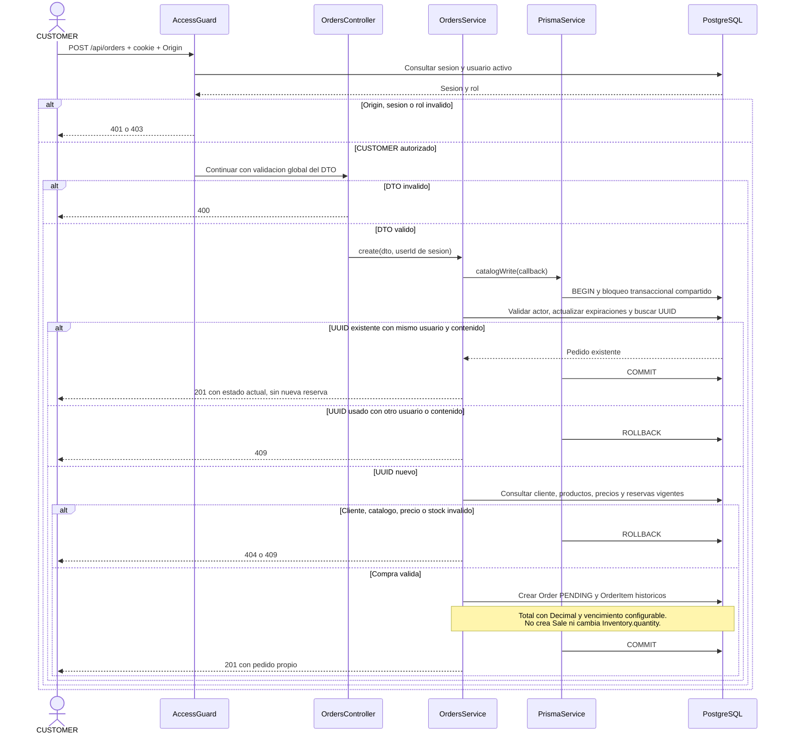
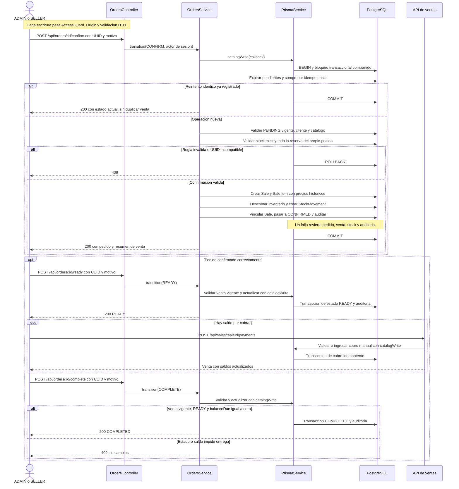

# UML de secuencia de pedidos

[Índice de diagramas](README.md) · [Contrato de pedidos](../orders-api.md)

## Crear un pedido

Se resume la validación de negocio posterior al DTO. También puede devolver 400
si el total excede el máximo permitido. Los errores inesperados revierten la
transacción y no se convierten en respuestas exitosas.

## Confirmar, cobrar y entregar

Los cobros pueden registrarse después de confirmar, antes o después de preparar.
La secuencia muestra un recorrido posible; no exige cobrar después de READY.
Una venta gratuita no necesita cobro. Ningún paso procesa una transacción bancaria.

La cancelación y el vencimiento se describen en el
[UML de estados](uml-order-states.md#estados-pedido).
