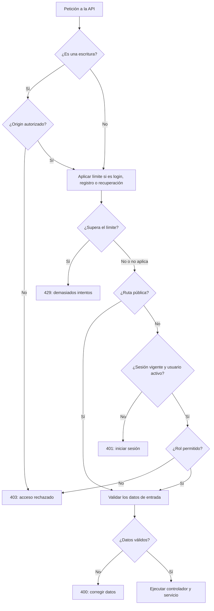
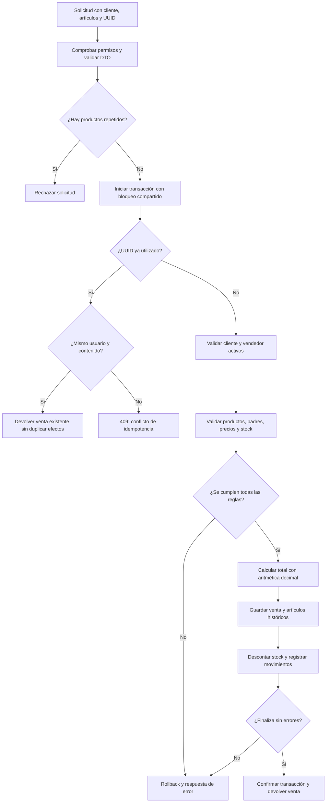
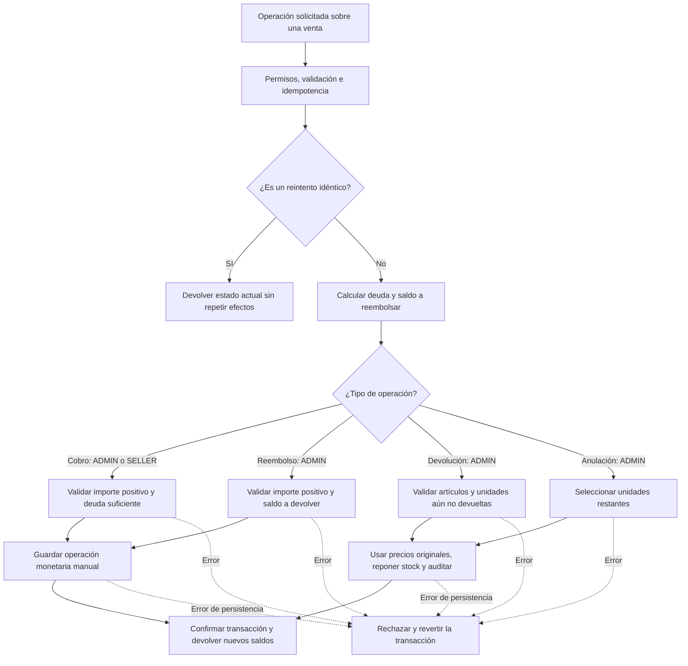
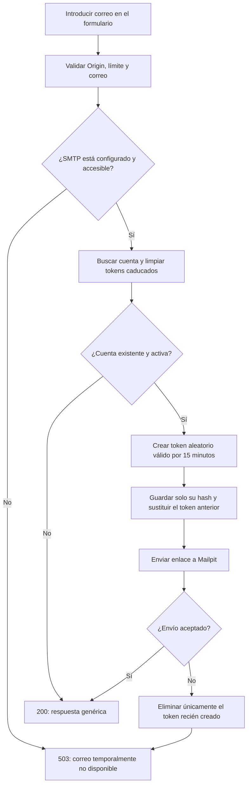
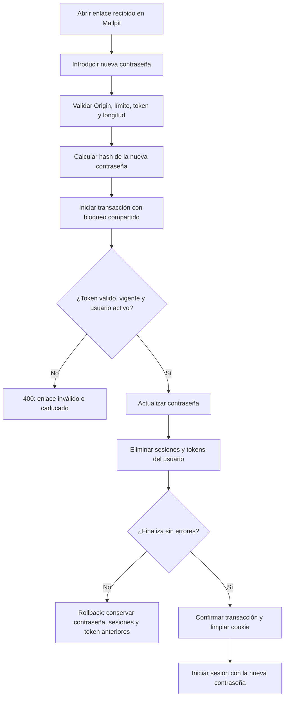
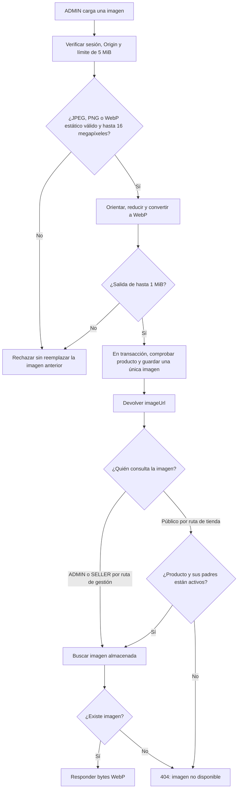
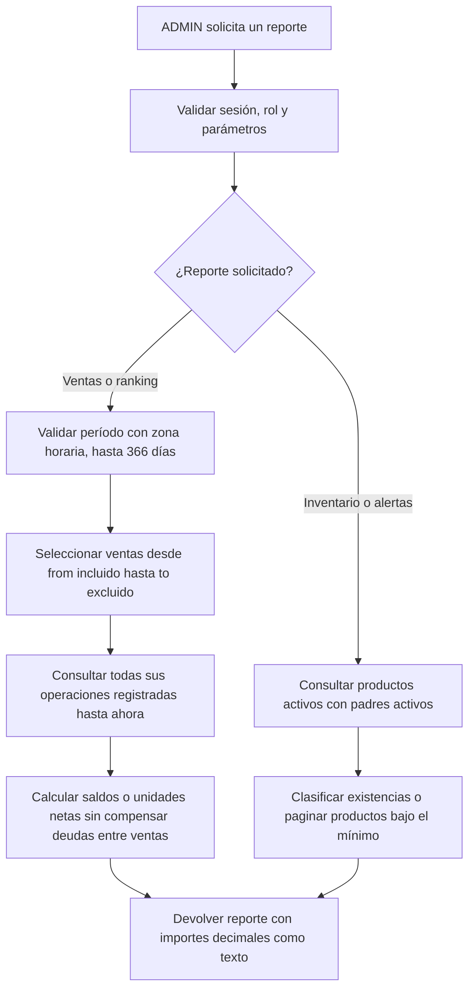
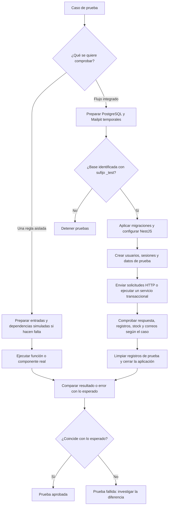

# Diagramas de flujo del backend

Estos diagramas describen la implementación actual. Los rectángulos son acciones,
los rombos son decisiones y las flechas indican el siguiente paso. Un rollback
deshace todos los cambios de la transacción; no revierte operaciones anteriores
ya confirmadas. Son vistas resumidas, no sustituyen los contratos de cada API.

El flujo de pedidos, reservas, preparación, cobro y retiro está en
[pedidos de autoservicio](orders-api.md#reservas-y-ciclo-de-vida).

## 1. Permisos de una petición

El guard se ejecuta antes de los DTO y del controlador. Una ruta pública de
escritura sigue necesitando un Origin autorizado.

Si no existe una regla explícita de rol, las lecturas de gestión permiten
ADMIN/SELLER y las escrituras ADMIN. La regla del método prevalece sobre la del
controlador. Ver [matriz de permisos](permissions-and-backlog.md).

## 2. Registrar una venta

ADMIN y SELLER pueden registrar ventas. El servidor obtiene al vendedor de su
sesión, calcula los importes y compara el precio esperado que envió el cliente.

Crear una venta no registra un cobro. Si falla una escritura, no debe quedar
una venta parcial ni un descuento de inventario sin su movimiento. Ver
[clientes y ventas](customers-sales-api.md).

## 3. Cobros, devoluciones y reembolsos

Después de comprobar permisos, DTO e idempotencia, el servicio consulta los
saldos actuales dentro del mismo bloqueo transaccional.

Una devolución o anulación puede generar saldo a devolver, pero no reembolsa
dinero automáticamente. El reembolso se registra por separado. Estos cobros y
reembolsos no ejecutan transacciones bancarias. Ver [operaciones de venta](sale-operations-api.md).

## 4. Solicitar recuperación de contraseña

El límite y Origin se verifican antes de ejecutar el servicio. Mailpit captura
los mensajes localmente; no los entrega a Internet.

La respuesta normal no revela si la cuenta existe. Pedir el enlace no cambia
la contraseña ni revoca sesiones. Si falla la base de datos, el error se propaga;
el diagrama muestra por separado los fallos de SMTP.

## 5. Confirmar una nueva contraseña

El enlace contiene el token en un fragmento. El formulario lo envía por POST,
junto con la nueva contraseña, y lo retira de la barra del navegador.

El mismo enlace no puede consumirse dos veces, ni siquiera con solicitudes
simultáneas. Ver [recuperación local](password-recovery-api.md).

## 6. Cargar y consultar imágenes

Las consultas pueden hacerse después, independientemente de la carga. Guardar
una imagen no cambia stock ni precios. Ver [contrato de imágenes](product-images-api.md).

## 7. Consultar reportes

El reporte de ventas refleja el estado actual de las ventas creadas en el
período. No reconstruye el saldo histórico al cierre ni mide los movimientos de
caja ocurridos exclusivamente durante ese período. Ver [reportes](reports-api.md).

## 8. Cómo funcionan las pruebas

Una prueba unitaria aísla una regla o componente. Una prueba de integración
conecta componentes reales y comprueba sus efectos persistidos.

Un rechazo esperado también puede aprobar una prueba. Por ejemplo, si SELLER
intenta subir una imagen y recibe 403, la protección funciona correctamente.
Los contenedores temporales se detienen y eliminan al terminar la ejecución
validada; nunca se usa la base habitual como sustituto. Ver [guía de pruebas](testing.md).
