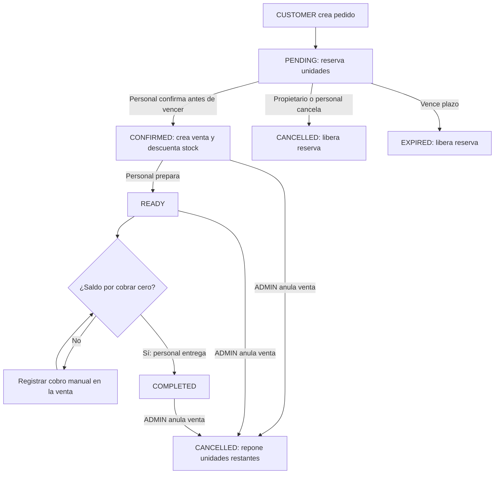

# Pedidos de autoservicio

Primera etapa: CUSTOMER autenticado, retiro en tienda (`fulfillment: "PICKUP"`)
y cobros manuales registrados por ADMIN/SELLER. No incluye carrito persistente,
envíos, pasarela ni notificaciones. Los clientes sin cuenta mantienen las ventas
de mostrador; necesitan una cuenta CUSTOMER para crear pedidos online.

## Rutas y permisos

Todas llevan `/api`, requieren sesión y, en escrituras, Origin autorizado.

| Método y ruta | Permiso y comportamiento |
| --- | --- |
| `POST /orders` | CUSTOMER: crear pedido propio; responde 201 |
| `GET /orders?page=1&limit=20&status=PENDING` | CUSTOMER: propios; ADMIN/SELLER: todos. Estado opcional |
| `GET /orders/:id` | Mismo aislamiento; pedido ajeno devuelve 404 |
| `POST /orders/:id/confirm` | ADMIN/SELLER: convertir PENDING vigente en venta |
| `POST /orders/:id/ready` | ADMIN/SELLER: CONFIRMED → READY |
| `POST /orders/:id/complete` | ADMIN/SELLER: READY → COMPLETED, con saldo por cobrar cero |
| `POST /orders/:id/cancel` | Propietario CUSTOMER o ADMIN/SELLER: cancelar solo PENDING |

Los IDs son enteros positivos. Las transiciones responden 200 y reciben
`{ "requestId": "UUID v4", "reason": "Motivo de la operación" }`.
El motivo se recorta y debe tener entre 3 y 500 caracteres.

## Crear un pedido

```json
{
  "requestId": "d49a904e-cfa6-4f87-8c21-f1aab5827fcb",
  "items": [
    { "productId": 1, "quantity": 2, "expectedUnitPrice": "25.00" }
  ]
}
```

Entre 1 y 100 productos distintos, cantidades enteras positivas y precios como
cadenas de dos decimales. El servidor obtiene el cliente activo de la sesión y
calcula importes con Decimal. Rechaza campos extra (`customerId`, `total`,
direcciones). Producto inexistente: 404; precio cambiado, catálogo inactivo o
stock insuficiente: 409; DTO inválido: 400. No guarda pedidos parciales.

La respuesta incluye `orderId`, `requestId`, datos históricos del cliente,
`status`, `fulfillment`, `total`, fechas e `items` con nombre/SKU/precio históricos.
Los importes son cadenas de dos decimales. `sale` es null hasta confirmar; después
contiene `saleId`, `status`, `total`, `adjustedTotal`, `paid`, `refunded`,
`balanceDue` y `refundDue`. Solo el personal recibe `userId` y `operations` de
auditoría. No se exponen hashes, costos ni información de otros compradores.
La lista devuelve `{ items, total, page, limit }`, con ID descendente.

## Reservas y ciclo de vida

Crear PENDING reserva unidades sin descontar stock físico ni registrar un
movimiento ficticio. `ORDER_RESERVATION_MINUTES` admite enteros de 1 a 10080;
por defecto 1440 (24 horas). Compose admite la misma variable.



Una reserva vencida deja de afectar disponibilidad exactamente en `expiresAt`.
Las lecturas y filtros reflejan EXPIRED aunque el trabajador aún no lo haya
persistido. Este actualiza estados al arrancar y cada 60 segundos; las escrituras
de pedidos también actualizan expiraciones en su transacción.

Confirmar conserva precios y datos originales, valida cliente/cuenta y catálogo
activos, genera una sola venta y registra la salida física con el usuario del
personal. Pedido, venta, stock y auditoría se confirman en una sola transacción.
Ventas de mostrador y movimientos manuales respetan las reservas de otros pedidos.
Preparar/entregar rechaza ventas anuladas o totalmente devueltas. Una venta
gratuita puede entregarse sin inventar cobros.

Tras confirmar, se cancela exclusivamente con `POST /api/sales/:saleId/cancel`
por ADMIN: repone unidades restantes y actualiza el pedido a CANCELLED en la
misma transacción. Los reembolsos son manuales; ninguna cancelación o devolución
procesa dinero automáticamente. Ver [ventas y clientes](customers-sales-api.md).

## Disponibilidad e impacto en el frontend

`GET /api/products/:id/inventory` añade `reservedQuantity` y `availableQuantity`.
El catálogo público `/api/shop/products` y su detalle añaden `availableQuantity`.
`quantity`, `minStock` y `stockStatus` conservan su significado de stock físico.
Disponibilidad = stock físico menos reservas PENDING no vencidas.
El frontend debe usar `availableQuantity` para compras y tratar 409 como petición
de actualizar precio o existencias. El servidor vuelve a validarlos.
Las pantallas de pedidos y botones de preparación/entrega requieren integración.

## Reintentos y persistencia

Mismo UUID, usuario y contenido devuelve el estado actual sin repetir efectos.
UUID reutilizado con otro usuario o contenido: 409. Tras expirar o cancelar,
un nuevo pedido requiere UUID nuevo. Creación y operaciones tienen espacios de
UUID separados. La auditoría guarda actor, nombre histórico, motivo y fecha;
anular una venta mantiene su auditoría en las operaciones de ventas.

Reservas, confirmaciones, ventas y movimientos comparten
`PrismaService.catalogWrite`, evitando sobreventa entre procesos y escrituras
parciales. La migración aditiva `20261013210000_customer_orders` crea Order,
OrderItem y OrderOperation con claves foráneas, índices y restricciones de
cantidades, importes y vinculación de venta según estado. Aplicar migraciones
antes de arrancar la nueva versión; no requiere semillas ni borrar datos.
