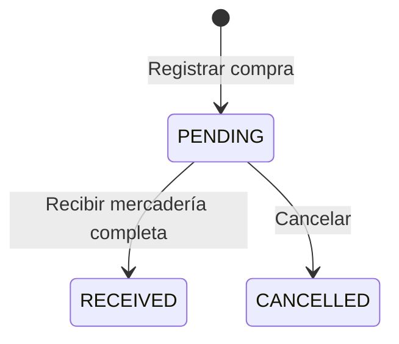

# Proveedores y compras

Implementado en NestJS y Nuxt. Todas las rutas requieren sesión ADMIN; SELLER y
CUSTOMER no pueden consultar proveedores, compras ni sus costos. Las escrituras
requieren Origin autorizado. No registra pagos ni procesa transferencias.

## Proveedores

- `GET /api/suppliers`: página `{items,total,page,limit}`; filtros `search`,
  `status=all|active|inactive`, `page` y `limit` (máximo 100).
- `GET /api/suppliers/:id`: detalle.
- `POST /api/suppliers`: `name` obligatorio (2–150 caracteres); opcionales
  `document`, `contactName`, `email`, `phone`, `address`, `notes`.
- `PATCH /api/suppliers/:id`: campos anteriores y `isActive`. Los opcionales
  admiten `null` para vaciarlos; `name` e `isActive` no admiten `null`.

Nombre único sin distinguir mayúsculas y documento único cuando está informado.
La baja es lógica. Un proveedor inactivo bloquea nuevas compras y recepciones,
pero conserva sus compras históricas y permite cancelar las pendientes.

## Compras

- `GET /api/purchases`: página con filtros `supplierId`, `status`, `search`,
  `page` y `limit`. Busca proveedor histórico, referencia, nombre o SKU comprado.
- `GET /api/purchases/:id`: cabecera, líneas e historial de operaciones.
- `POST /api/purchases`: registra una compra **PENDING**, sin modificar stock.

```json
{
  "requestId": "5c90d01b-914d-4539-91cc-798a3d9b6ad7",
  "supplierId": 1,
  "reference": "COMPROBANTE-001",
  "notes": "Mercadería para reposición",
  "items": [{ "productId": 1, "quantity": 3, "unitCost": "10.00" }]
}
```

`requestId` es UUID v4. Se permiten de 1 a 100 productos diferentes, cantidades
enteras positivas y costos no negativos con dos decimales. El servidor calcula
subtotales y total usando Decimal y rechaza desbordamientos. El proveedor,
producto, categoría y subcategoría deben estar activos. Se conservan nombres,
documento del proveedor, SKU y costos históricos aunque cambie el catálogo.

- `POST /api/purchases/:id/receive` (HTTP 200): `{requestId,reason,updateCost?}`.
  Motivo de 3–500 caracteres; `updateCost` booleano, por defecto `false`.
  Recibe **todas** las líneas y pasa a RECEIVED. Cada entrada incrementa stock y
  registra usuario, motivo, cantidad anterior/resultante y vínculo a PurchaseItem.
  El proveedor y catálogo se vuelven a validar. Si se solicita, el costo actual
  del producto pasa a ser el costo unitario comprado; el precio de venta no cambia.
- `POST /api/purchases/:id/cancel` (HTTP 200): `{requestId,reason}`. Solo PENDING;
  pasa a CANCELLED sin movimientos ni cambios de costo.



Las compras y sus líneas son inmutables. Para corregir una pendiente, cancélala
y registra otra. Esta versión no incluye recepción parcial, devolución al
proveedor, cuentas por pagar, impuestos, fletes ni modificación de una recibida.

## Consistencia y reintentos

Creación, recepción y cancelación usan `PrismaService.catalogWrite`, compartido
con inventario, catálogo, pedidos y ventas. Stock, costos, estado y auditoría se
confirman en una única transacción o se revierten juntos. La recepción rechaza
cantidades que excedan el máximo del inventario.

Repetir el mismo UUID, usuario y contenido devuelve la compra sin duplicarla ni
reponer stock nuevamente. Reutilizar UUID con otra operación, usuario o contenido
devuelve 409. Un UUID nuevo no permite recibir una compra ya recibida.
La respuesta no expone hashes internos. El frontend conserva operaciones por
confirmar en sessionStorage cuando está disponible y bloquea cambios hasta resolverlas.

La migración `20261014180000_suppliers_purchases` es aditiva y no modifica los
registros existentes. El historial de inventario añade `purchaseItem.purchaseId`;
Nuxt muestra el enlace a la compra solo para ADMIN.

## Validación

`test/purchases.e2e-spec.ts` cubre permisos y Origin reales, validaciones,
unicidad, bajas lógicas, búsquedas, importes exactos, snapshots, idempotencia,
recepciones concurrentes, costos opcionales, cancelación, desbordamiento y un
fallo intermedio de base de datos que verifica rollback completo y reintento seguro.
